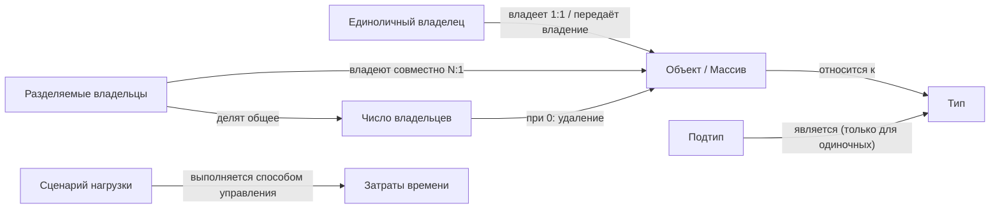
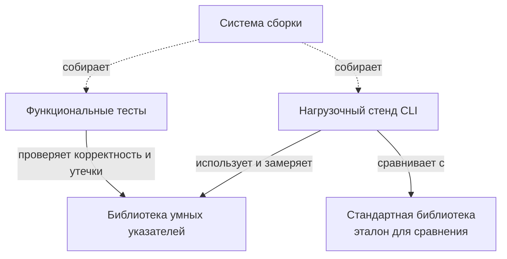
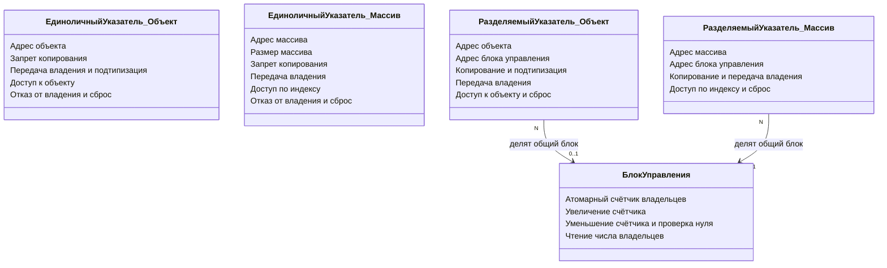

# Дизайн (ТЗ): Лабораторная работа №1 «Умные указатели»

Документ описывает результаты анализа задачи и спроектированное решение на концептуальном уровне, без привязки к деталям физической реализации.

---

## 1. Постановка задачи

### 1.1. Что делается в работе
При работе с динамической памятью (кучей) ручное управление ресурсами часто приводит к ошибкам: утечкам памяти (объект забыли удалить), двойному освобождению, обращению по висячей ссылке и неверному способу удаления массивов.

Идея работы — переложить ответственность за освобождение памяти на **умные указатели** (принцип автоматического управления временем жизни ресурса). Умный указатель владеет объектом в куче и гарантированно удаляет его, когда тот перестаёт быть нужен.

В системе реализуются два вида владения (для одиночных объектов и для массивов):
* **Единоличное владение** — у ресурса ровно один владелец; право владения можно передать другому указателю, но нельзя скопировать.
* **Разделяемое владение** — одним ресурсом могут совместно владеть несколько равноправных указателей; подсчёт владельцев ведётся децентрализованно (через общий блок управления), а ресурс удаляется последним уходящим владельцем.

Для одиночных объектов поддерживается **подтипизация**: указатель на производный тип можно использовать как указатель на базовый тип. Для подтверждения корректности и оценки эффективности в систему входят модуль автоматических тестов (проверка логики и отсутствия утечек) и консольный нагрузочный стенд (сравнение времени работы с обычными указателями и стандартной библиотекой).

### 1.2. Зачем это нужно
Общий класс решаемых задач — **автоматическое управление временем жизни ресурсов**:
* безопасное хранение узлов в динамических структурах данных (деревья, списки, графы);
* совместное использование общих данных несколькими частями программы (кэш, общие настройки, буферы);
* явная передача ответственности за ресурс между функциями и модулями;
* защита от утечек памяти при раннем выходе из функций и возникновении исключений.

Сравнительное тестирование со стандартной библиотекой позволяет на практике оценить накладные расходы абстракций (выделение блока управления, потокобезопасный подсчёт ссылок, передача владения).

---

## 2. Сущности прикладной задачи

### 2.1. Сущности

| Сущность | Описание |
| :--- | :--- |
| **Объект** | Данные в динамической памяти, имеющие время жизни от создания до удаления. |
| **Массив объектов** | Непрерывный блок однотипных объектов в куче; требует особого способа удаления и даёт доступ по индексу. |
| **Владелец** | Сущность, отвечающая за удаление объекта или массива, когда ресурс перестаёт использоваться. |
| **Единоличное владение** | Режим 1:1 — у ресурса ровно один владелец; владение можно передать, но нельзя размножить. |
| **Разделяемое владение** | Режим N:1 — ресурсом владеют несколько равноправных владельцев; копирование добавляет нового владельца. |
| **Число владельцев** | Текущее количество активных разделяемых владельцев одного ресурса; при обнулении ресурс удаляется. |
| **Тип и подтип** | Иерархия наследования: подтип является частным случаем базового типа. |
| **Утечка памяти** | Ресурс в куче, на который не осталось ни одного владельца, но память не освобождена. |
| **Сценарий нагрузки** | Повторяемая $N$ раз последовательность операций (создание, перемещение, копирование, удаление) для оценки затрат. |
| **Затраты времени** | Время выполнения сценария нагрузки для разных способов управления памятью (обычный указатель, своё решение, стандартная библиотека). |

### 2.2. Связи между сущностями

* **Владение (1:1 и N:1):** владелец обязан освободить ресурс при завершении своей работы; без владельца возникает утечка.
* **Передача владения:** единоличный владелец отдаёт ресурс другому и становится пустым.
* **Совместное владение и счётчик:** копирование разделяемого владельца увеличивает число владельцев, уход — уменьшает; последний владелец удаляет ресурс.
* **Подтипизация:** ссылку-владельца на подтип можно использовать как ссылку на базовый тип (для массивов запрещено из-за разного размера элементов).
* **Оценка затрат:** каждый сценарий нагрузки выполняется тремя способами управления памятью и даёт сравнительные затраты времени.

---

## 3. Архитектура

### 3.1. Компоненты системы

| Компонент | Вид | Назначение |
| :--- | :--- | :--- |
| **Библиотека умных указателей** | Библиотечный | Реализует единоличное и разделяемое владение объектами и массивами, блок управления и подтипизацию. |
| **Нагрузочный стенд** | Прикладная логика + CLI | Выполняет 5 сценариев нагрузки (создание, перемещение, массивы, копирование), измеряет время и выводит сводные таблицы с отношением к эталону в консоль. |
| **Функциональные тесты** | Проверка | Автоматически проверяет все сценарии владения, подтипизации, запрета копирования и отсутствия утечек памяти. |
| **Система сборки** | Инфраструктурный | Собирает исполняемые модули стенда и тестов, подключает фреймворк тестирования. |

Пользовательский интерфейс — **консольный (CLI)**.

### 3.2. Связи между компонентами и логическая структура

#### Взаимодействие компонентов

#### Логическая структура классов и блока управления

### 3.3. Описание компонентов, структур данных и решений

* **Библиотека умных указателей:**
    * *Структуры данных:* единоличный указатель на объект хранит только адрес (размер равен обычному указателю); версия для массива дополнительно хранит число элементов; разделяемый указатель хранит адрес ресурса и адрес общего блока управления в куче (для пустого указателя блок не выделяется).
    * *Блок управления:* хранит потокобезопасный (атомарный) счётчик владельцев, что исключает гонки данных при одновременном копировании и удалении указателей из разных потоков.
    * *Ключевые алгоритмы:* все операции владения (перемещение, копирование разделяемого указателя, изменение счётчика) выполняются за константное время $O(1)$. При присваивании разделяемого указателя проверяется совпадение блоков управления — это исключает лишнюю работу со счётчиком при самоприсваивании и присваивании между владельцами одного объекта.
    * *Архитектурные решения:* разделение одиночных объектов и массивов выполняется на этапе компиляции (без флагов и проверок во время работы); подтипизация для массивов запрещена; захват обычного адреса и проверка на пустоту делаются явными, чтобы исключить случайные неявные преобразования; ядро библиотеки не зависит от стандартных умных указателей и контейнеров.
* **Функциональные тесты:** используют тестовый класс-наблюдатель со статическим счётчиком живых экземпляров (и его наследник для проверки подтипизации). После выхода указателей из локальной области видимости проверяется, что число живых объектов равно нулю. Запрет копирования единоличного указателя проверяется на этапе компиляции.
* **Нагрузочный стенд:** замеряет время выполнения 5 сценариев (создание/удаление одиночного объекта, чистое перемещение, работа с массивами, полный цикл разделяемого владения и чистое копирование как стресс-тест блока управления) на объёмах до $10^7$ операций. Предусмотрена защита от вырезания измеряемых циклов оптимизатором компилятора.

---

## 4. Функциональные требования

### 4.1. К единоличному указателю (объект и массив)
* **Создать:** пустой указатель или указатель, владеющий новым объектом / массивом (с указанием размера для массива).
* **Получить доступ:** обращение к объекту, доступ к элементу массива по индексу, получение размера массива, получение обычного адреса, проверка на пустоту.
* **Передать владение:** перенос ресурса в другой указатель с обнулением исходного.
    * *Особые сценарии:* попытка копирования — ошибка на этапе компиляции; передача владения самому себе не теряет ресурс.
* **Управлять владением:** отказаться от владения без удаления объекта; заменить или сбросить ресурс.
    * *Особый сценарий:* замена тем же самым адресом не удаляет объект.
* **Автоматически удалить** объект или массив правильным способом при уничтожении указателя.

### 4.2. К разделяемому указателю (объект и массив)
* **Создать:** пустой указатель (число владельцев 0, блок управления не создаётся) или от обычного адреса (число владельцев 1).
* **Скопировать и присвоить:** добавить нового владельца; при присваивании отпустить старый ресурс.
    * *Особые сценарии:* самоприсваивание и присваивание между двумя владельцами одного объекта не разрушают ресурс и не выполняют лишних операций со счётчиком.
* **Переместить:** передать долю владения без изменения счётчика, обнулив исходный указатель.
* **Получить доступ и информацию:** обращение к объекту или элементу массива, получение адреса, получение числа владельцев, проверка на пустоту, сброс и замена ресурса.
* **Автоматически удалить** ресурс и блок управления при уходе последнего владельца.

### 4.3. К подтипизации
* Преобразование указателя на подтип в указатель на базовый тип (для единоличного — через передачу владения; для разделяемого — с сохранением общего блока управления).
* *Особый сценарий:* преобразования от базового типа к подтипу, между несвязанными типами и любые преобразования для массивов запрещены на этапе компиляции.

### 4.4. К системе в целом
* **Верификация:** автоматический прогон всех функциональных тестов с подтверждением отсутствия утечек памяти.
* **Бенчмаркинг:** измерение времени выполнения 5 сценариев нагрузки для обычных указателей, собственной реализации и эталона из стандартной библиотеки с выводом сводных таблиц и отношения времени работы в консоль.

---

## 5. Нефункциональные требования и ограничения

* **Производительность:** при включённых оптимизациях компилятора единоличный указатель работает без накладных расходов относительно ручного управления памятью.
* **Безопасность и надёжность:** отсутствие утечек памяти и двойного удаления; отсутствие исключений при перемещении и чтении состояния; потокобезопасный подсчёт ссылок в блоке управления.
* **Независимость и интерфейс:** ядро библиотеки не зависит от стандартных умных указателей, тестов и стенда; автоматизированная сборка; консольный интерфейс.
* **Ограничения:** слабые ссылки не реализуются (циклические ссылки приводят к утечке памяти); один и тот же обычный адрес нельзя передавать в два независимых умных указателя; корректное удаление объекта подтипа через указатель на базовый тип требует виртуального деструктора базового типа.